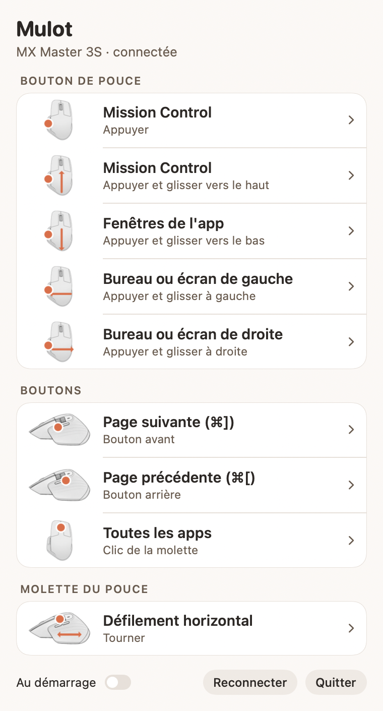
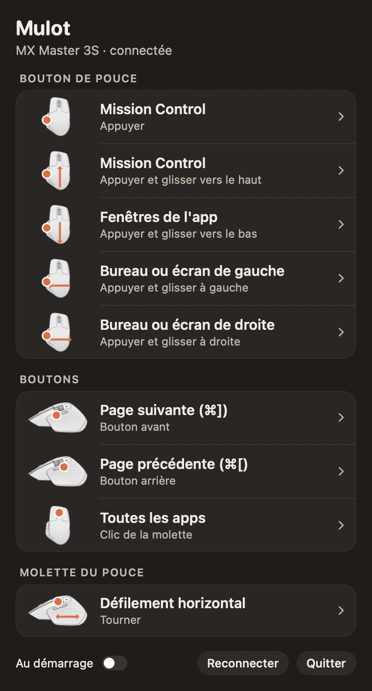

# Mulot

**A tiny menu bar app for macOS that replaces Logi Options+ for the Logitech MX Master mouse over Bluetooth.**
No account, no Logitech software, no background updater: just your buttons and thumb gestures.

*[Version française plus bas](#français)*

<p align="center">
  
  
</p>

## What it does

- **Gesture button (thumb):** click opens Mission Control. Hold and move up: Mission Control; down: the app's windows; left or right: the neighbouring desktop (or full-screen app), otherwise the other display.
- **Forward and back buttons:** next and previous page (⌘] and ⌘[).
- **Wheel click:** all apps.
- **Thumb wheel:** horizontal scrolling, or switch tabs, volume, zoom or desktops.
- **Button behind the wheel:** keeps its original role (ratchet / free spin), handled by the mouse itself.
- Every slot can also: move the window to the left or right display, show the desktop, middle click, play/pause, Spotlight, screenshot, copy, paste, close tab.
- Battery level in the menu bar and in the window.

## Compatibility

| Mouse | Status |
|---|---|
| MX Master 3S (Bluetooth) | Tested |
| MX Master 3, MX Master 2S (Bluetooth) | Should work (same gesture button), not tested yet |
| MX Master 4 (Bluetooth) | Probably works for buttons and gesture button; its haptic panel is not supported |
| Any mouse through a Logi Bolt or Unifying USB receiver | Not supported: Mulot only talks to the mouse over direct Bluetooth |

Forward/back buttons and the thumb wheel use standard macOS events, so they work with most mice. The gesture button needs Logitech's HID++ protocol. Feedback on other models is very welcome: open an issue with the content of `~/Library/Logs/Mulot.log`.

Requires macOS 13 Ventura or later. Quit Logi Options+ before using Mulot: both cannot drive the mouse at the same time.

## Install

There is no signed download yet: build it yourself (it takes a few seconds).

1. Install Xcode or the Command Line Tools (`xcode-select --install`).
2. Clone and build:
   ```bash
   git clone https://github.com/GauthierAube/Mulot.git
   cd Mulot
   ./build.sh --install
   ```
   The app is copied to `/Applications` and launched.
3. In **System Settings › Privacy & Security**, allow Mulot in **Input Monitoring** and **Accessibility**, then click *Reconnect* in Mulot's window.

## How it works

- Mulot talks to the mouse over Bluetooth with Logitech's HID++ 2.0 protocol, to "divert" the gesture button so its presses reach Mulot instead of being lost.
- The mouse forgets this setting when it goes to sleep, so Mulot asks again every 15 seconds and when the Mac wakes up.
- The other buttons and the thumb wheel are intercepted with a standard macOS event tap (hence the Accessibility permission).
- Log file: `~/Library/Logs/Mulot.log`.
- Change log (in French): [change-mulot.md](change-mulot.md).

The interface is currently in French only. Translations are welcome.

## Licence

MIT, see [LICENSE](LICENSE). Mulot is an independent project, not affiliated with or endorsed by Logitech. Logitech, MX Master and Logi Options+ are trademarks of Logitech.

---

## Français

**Une petite app Mac, dans la barre des menus, qui remplace Logi Options+ pour la souris Logitech MX Master en Bluetooth.**
Sans compte, sans logiciel Logitech, sans mises à jour en arrière-plan : juste tes boutons et les gestes du pouce.

### Ce qu'elle fait

- **Bouton de pouce :** un clic ouvre Mission Control. Appuyer et glisser vers le haut : Mission Control ; vers le bas : les fenêtres de l'app ; à gauche ou à droite : le bureau voisin (ou l'app en plein écran voisine), sinon l'autre écran.
- **Boutons avant et arrière :** page suivante et page précédente (⌘] et ⌘[).
- **Clic de la molette :** toutes les apps.
- **Molette du pouce :** défilement horizontal, ou changer d'onglet, le volume, le zoom ou le bureau.
- **Bouton derrière la molette :** garde son rôle d'origine (cran ou roue libre), géré par la souris elle-même.
- Chaque bouton peut aussi : envoyer la fenêtre sur l'écran de gauche ou de droite, afficher le bureau, clic du milieu, lecture/pause, Spotlight, capture d'écran, copier, coller, fermer l'onglet.
- Le niveau de batterie dans la barre des menus et dans la fenêtre.

### Souris compatibles

| Souris | État |
|---|---|
| MX Master 3S (Bluetooth) | Testée |
| MX Master 3, MX Master 2S (Bluetooth) | Devrait marcher (même bouton de pouce), pas encore testée |
| MX Master 4 (Bluetooth) | Marche probablement pour les boutons et le bouton de pouce ; son panneau haptique n'est pas géré |
| Toute souris branchée par un récepteur USB Logi Bolt ou Unifying | Non gérée : Mulot parle à la souris uniquement en Bluetooth direct |

Les boutons avant/arrière et la molette du pouce passent par des événements macOS standards : ils marchent avec la plupart des souris. Le bouton de pouce a besoin du protocole HID++ de Logitech. Tes retours sur d'autres modèles sont les bienvenus : ouvre une *issue* avec le contenu de `~/Library/Logs/Mulot.log`.

Il faut macOS 13 Ventura ou plus récent. Quitte Logi Options+ avant d'utiliser Mulot : les deux ne peuvent pas piloter la souris en même temps.

### Installer

Il n'y a pas encore de version signée à télécharger : il faut la compiler soi-même (quelques secondes).

1. Installe Xcode ou les outils en ligne de commande (`xcode-select --install`).
2. Télécharge et compile :
   ```bash
   git clone https://github.com/GauthierAube/Mulot.git
   cd Mulot
   ./build.sh --install
   ```
   L'app est copiée dans `/Applications` et lancée.
3. Dans **Réglages Système › Confidentialité et sécurité**, autorise Mulot dans **Surveillance de la saisie** et **Accessibilité**, puis clique sur *Reconnecter* dans la fenêtre de Mulot.

### Licence

MIT, voir [LICENSE](LICENSE). Mulot est un projet indépendant, ni affilié à Logitech ni approuvé par Logitech. Logitech, MX Master et Logi Options+ sont des marques de Logitech.
